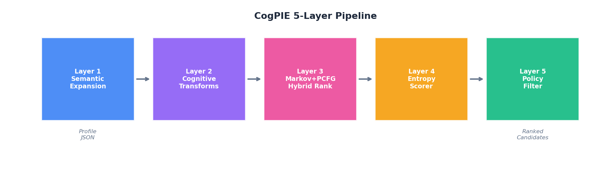
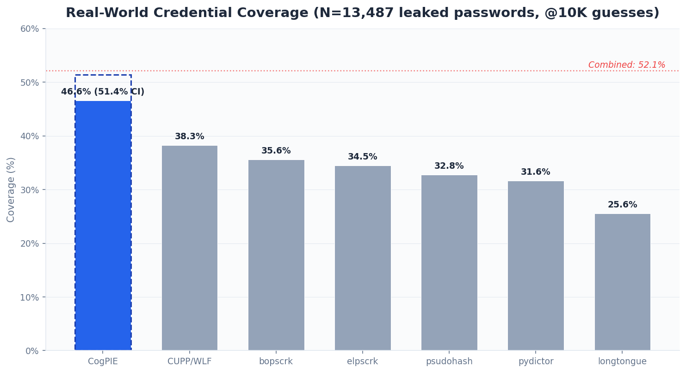
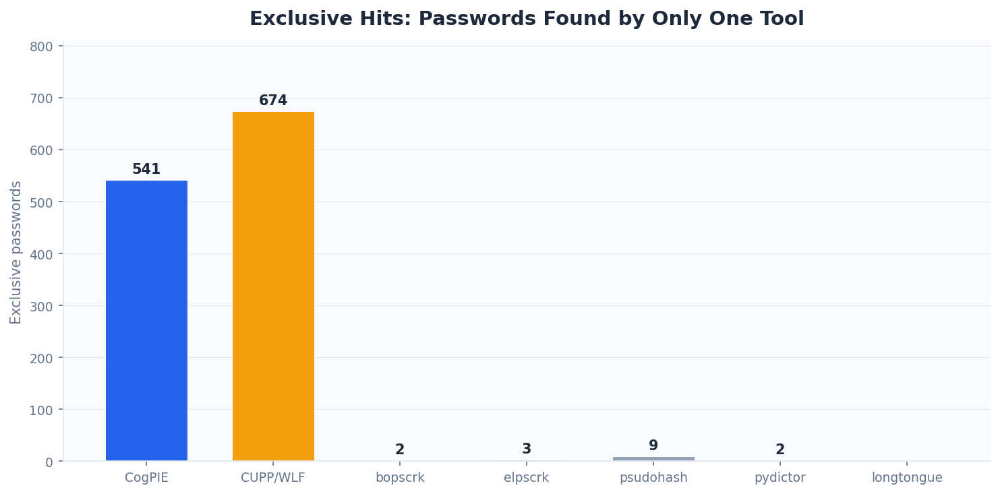
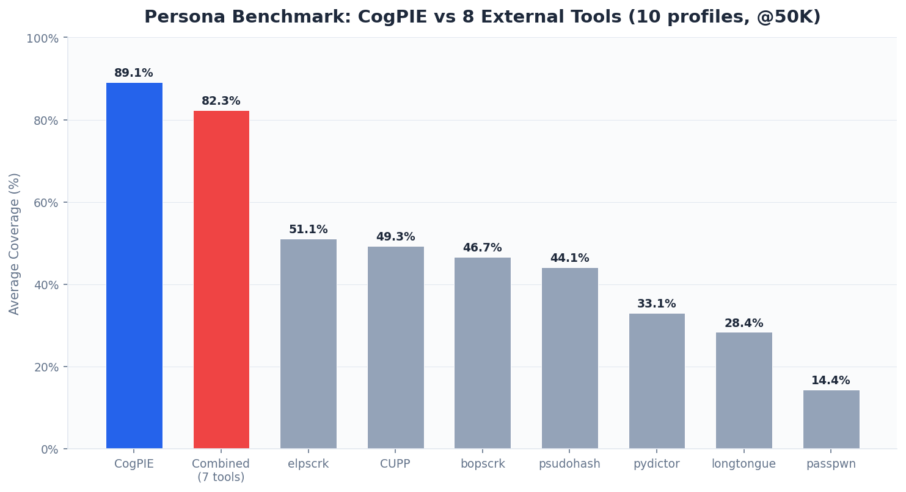

# CogPIE: Cognitive Pattern Inference Engine

[](https://pypi.org/project/cogpie/)
[](https://pypi.org/project/cogpie/)
[](https://opensource.org/licenses/MIT)

A hybrid multi-layer password candidate generator that models cognitive biases in human password creation. CogPIE predicts PII-derived passwords with high accuracy by combining semantic expansion, psychologically-motivated transforms, probabilistic ranking (Markov + PCFG), entropy scoring, and policy-aware filtering.

**46.6% coverage on 13,487 real leaked credentials** (51.4% case-insensitive), outperforming all 6 competing tools by +8.3pp or more.

## Architecture

CogPIE implements a 5-layer pipeline that transforms a target profile into ranked password candidates:



| Layer | Component | Function |
|-------|-----------|----------|
| **1** | Semantic Expander | Expands profile tokens (names, dates, keywords) into variants: nicknames, abbreviations, transliterations, cultural forms |
| **2** | Cognitive Transforms | Applies bias-driven rules: leetspeak, case mutations, anchoring suffixes, position-serial patterns, cross-field joins |
| **3** | Markov+PCFG Hybrid | Scores candidates using a character-level Markov model combined with PCFG structural templates trained on real corpora |
| **4** | Entropy Scorer | Estimates practical guessability (zxcvbn-inspired), penalizes low-entropy and rewards high-probability patterns |
| **5** | Policy Filter | Enforces password policy constraints (length, complexity) with CRC32 deduplication |

## Installation

```bash
pip install cogpie
```

For CUDA-accelerated ranking (20x speedup):

```bash
pip install cogpie[gpu]
```

Requires Python >= 3.10. GPU backend requires PyTorch >= 2.0 with CUDA.

## Quick Start

```python
from cogpie import CogPIEEngine

engine = CogPIEEngine()

profile = {
    "names": ["joao", "silva"],
    "dates": ["1990", "0315"],
    "keywords": ["flamengo", "guitar"],
    "pets": ["rex"],
    "companies": ["acme"],
    "phones": [],
    "emails": ["joao.silva@gmail.com"],
    "old_passwords": ["joao123"],
    "numbers": ["42"],
}

candidates = engine.generate(profile, max_candidates=10000)
for password, meta in candidates[:10]:
    print(f"{password}: {meta['hybrid_score']:.6f}")
```

### CLI

```bash
# Basic usage
cogpie --profile target.json --max 50000 -o candidates.txt

# With corpus training (improves Markov ranking)
cogpie --profile target.json --corpus rockyou.txt --max 100000 -o output.txt

# With password policy enforcement
cogpie --profile target.json --policy-min 8 --policy-classes 3 --max 50000

# GPU acceleration + statistics
cogpie --profile target.json --corpus rockyou.txt --max 100000 --stats -v
```

### Profile JSON Format

```json
{
    "names": ["first_name", "last_name", "nickname"],
    "dates": ["1990", "0315", "2510"],
    "keywords": ["favorite_team", "hobby", "band"],
    "pets": ["pet_name"],
    "companies": ["employer"],
    "phones": ["11999998888"],
    "emails": ["user@example.com"],
    "old_passwords": ["known_old_password"],
    "numbers": ["lucky_number", "apartment"]
}
```

## Benchmark Results

### Real-World Credential Benchmark (N=13,487)

Evaluated against **13,487 real leaked credentials** with embedded PII extracted from public breach compilations (260K+ credentials, PII-filtered, no synthetic data). Each tool received the same profile data and a budget of 10,000 candidates.



| Tool | Hits | Coverage | CI Coverage | Exclusive | Med. Rank |
|------|------|----------|-------------|-----------|-----------|
| **CogPIE** | **6,286** | **46.6%** | **51.4%** | **541** | 20 |
| CUPP/WLF | 5,161 | 38.3% | 38.5% | 674 | 8 |
| bopscrk | 4,799 | 35.6% | 36.5% | 2 | 6 |
| elpscrk | 4,652 | 34.5% | 35.0% | 3 | 9 |
| psudohash | 4,418 | 32.8% | 33.2% | 9 | 20 |
| pydictor | 4,267 | 31.6% | 32.4% | 2 | 10 |
| longtongue | 3,446 | 25.6% | 26.3% | 0 | 9 |
| **Combined** | **7,032** | **52.1%** | | | |

**Key findings:**

- **CogPIE leads by +8.3pp** over the next best tool (CUPP, 38.3%)
- **541 exclusive hits**: passwords found only by CogPIE, invisible to all 6 competitors
- CogPIE alone covers **89.4% of the combined** 7-tool coverage (6,286 / 7,032)
- Corpus is globally diverse: 73.3% webmail, 3.8% CN/TW/HK, 0.6% .br domains
- 95% CI for CogPIE coverage: [45.8%, 47.5%]

### Exclusive Hits Analysis



CogPIE's 541 exclusive hits demonstrate that cognitive bias modeling captures password patterns orthogonal to traditional combinatorial heuristics. These are passwords that no other tool generates within 10K candidates.

### Persona Benchmark (10 profiles, @50K candidates)

Controlled evaluation with 10 synthetic personas (15-31 ground-truth passwords each) against 8 real external tools.



| Tool | Avg Coverage | vs CogPIE |
|------|-------------|-----------|
| **CogPIE** | **89.1%** | baseline |
| Combined (7 tools) | 82.3% | -6.8pp |
| elpscrk | 51.1% | -38.0pp |
| CUPP | 49.3% | -39.8pp |
| bopscrk | 46.7% | -42.4pp |
| psudohash | 44.1% | -45.0pp |
| pydictor | 33.1% | -56.0pp |
| longtongue | 28.4% | -60.7pp |
| passpwn | 14.4% | -74.7pp |

CogPIE wins **10/10 personas individually** against any single tool, and **7/10 against the combined output** of all 7 competitors merged.

## GPU Acceleration

CUDA backend provides 20x throughput on RTX 4060 (1M training corpus):

| Mode | Time/Profile | VRAM |
|------|-------------|------|
| CPU | 15.12s | 0 |
| **GPU (CUDA)** | **0.75s** | 174 MB |

Falls back to CPU automatically when CUDA is unavailable:

```python
engine = CogPIEEngine(use_gpu=True)  # auto-fallback if no CUDA
```

## How It Works

CogPIE is grounded in cognitive science research on password creation behavior:

1. **Anchoring bias**: users build passwords around a recognizable base word
2. **Position-serial effect**: modifications concentrate at the start and end
3. **Hyperbolic discounting**: memorability is prioritized over security
4. **Familiarity heuristic**: personally significant tokens (names, dates, pets) dominate

The engine exploits these biases systematically across 5 layers, producing candidates ordered by estimated real-world probability. Training on a password corpus (e.g., RockYou) calibrates the Markov+PCFG ranker to match observed character-level and structural patterns.

The central thesis, supported by empirical evidence at scale: **cognitive bias in password creation is universal, cross-cultural, and resistant to complexity policies**. It is not a failure of education but a fundamental property of human cognition.

## API Reference

### `CogPIEEngine`

```python
class CogPIEEngine:
    def __init__(
        self,
        alpha: float = 0.6,        # Markov weight in hybrid score
        beta: float = 0.4,         # PCFG weight in hybrid score
        markov_order: int = 3,     # Character n-gram order
        use_gpu: bool = False,     # Enable CUDA acceleration
    ): ...

    def generate(
        self,
        profile: dict[str, Any],
        policy: PasswordPolicy | None = None,
        max_candidates: int = 100_000,
    ) -> list[tuple[str, dict[str, Any]]]: ...

    def train(self, corpus_path: str, max_lines: int = 0) -> int: ...
```

### `PasswordPolicy`

```python
from cogpie.policy_filter import PasswordPolicy

policy = PasswordPolicy(
    min_length=8,
    max_length=64,
    min_char_classes=3,  # lowercase, uppercase, digits, special
)
```

### `correlate_password`

```python
from cogpie.pii_correlator import correlate_password

result = correlate_password("joao1990!")
# result.category: "hybrid" (name + date components)
# result.name_match: "joao"
# result.date_match: "1990"
```

## Requirements

- Python >= 3.10
- No mandatory dependencies (stdlib only)
- Optional: PyTorch >= 2.0 with CUDA for GPU acceleration

## Research

CogPIE is backed by an academic paper with 42 references, formal mathematical foundations for each layer, complexity analysis, and empirical validation. Mappings to MITRE ATT&CK (T1110), CWE-521, OWASP A07:2021, and NIST SP 800-63B.

## Author

**Andre Henrique de Oliveira** ([@mrhenrike](https://github.com/mrhenrike)) / [Uniao Geek](https://uniaogeek.com.br)

## License

[MIT License](LICENSE)
